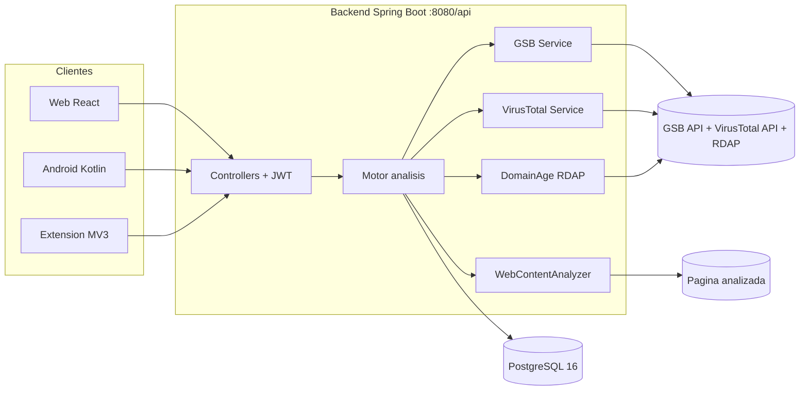
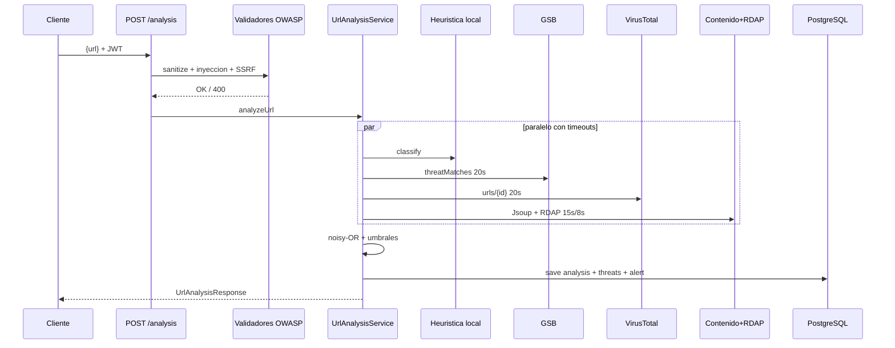
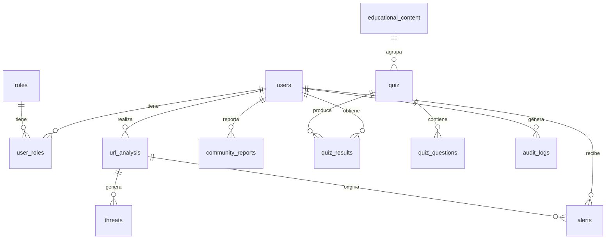

# Informe técnico – PhishWare

**Universidad Cooperativa de Colombia — Facultad de Ingeniería — Ingeniería de Software — Pasto, 9 de noviembre de 2026.**
**Autores del proyecto de grado:** Camila Isabel Bastidas Riascos y Jesús David Villota Arteaga.
**Alcance de este informe:** auditoría técnica de solo lectura del repositorio `ghosstbabby12/PHISWARE` (rama `main`). No se modificó ningún archivo del proyecto; solo se crean este `.md` y su versión `.pdf`.

---

## Tabla de contenido

1. [Resumen general](#1-resumen-general)
2. [Stack tecnológico por componente](#2-stack-tecnológico-por-componente)
3. [Arquitectura](#3-arquitectura)
4. [Backend – API](#4-backend--api)
5. [Motor de detección](#5-motor-de-detección)
6. [Base de datos](#6-base-de-datos)
7. [Aplicación web](#7-aplicación-web)
8. [Extensión de navegador](#8-extensión-de-navegador)
9. [Aplicación Android](#9-aplicación-android)
10. [Seguridad (OWASP y NIST)](#10-seguridad-owasp-y-nist)
11. [Pruebas y evaluación](#11-pruebas-y-evaluación)
12. [Despliegue y configuración](#12-despliegue-y-configuración)
13. [Documentación existente](#13-documentación-existente)
14. [Problemas detectados](#14-problemas-detectados)
15. [Historial del proyecto (git)](#15-historial-del-proyecto-git)
16. [Tabla final de estado](#16-tabla-final-de-estado)

---

## 1. Resumen general

PhishWare es un sistema cliente-servidor para la **detección y prevención de phishing** que combina análisis automatizado de URL, alertas preventivas y un módulo educativo con gamificación. Consta de cuatro piezas: (a) **backend** Spring Boot que expone una API REST con JWT y ejecuta el motor de análisis multi-fuente (heurística léxica + contenido de página + antigüedad del dominio + Google Safe Browsing + VirusTotal combinados con noisy-OR); (b) **frontend web** React + TypeScript con dashboard, análisis, historial, educación/quizzes y panel admin; (c) **extensión Chrome/Edge Manifest V3** que analiza páginas automáticamente, tiñe enlaces y bloquea clics peligrosos; (d) **app Android** Kotlin (MVVM + Hilt, UI en XML) con análisis manual, enlace compartido, SMS, QR y escucha de notificaciones. Persiste en **PostgreSQL 16** con migraciones **Flyway V1–V6**. El modo sin claves API degrada a **HEURISTIC_ONLY**. El piloto de usuarios y la calificación ISO están pendientes (1 participante real, rúbrica vacía).

### Árbol de carpetas (3 niveles)

```text
PHISWARE/
├── docs/
│   ├── architecture/ARCHITECTURE.md
│   ├── security/OWASP_NIST_MAPPING.md
│   └── tests/ (scripts .py, .jmx, .csv, .json, piloto/, iso25010_rubrica.csv)
├── phishware-backend/
│   ├── src/main/java/com/phishware/ (config, controller, dto, entity, exception, repository, security, service)
│   ├── src/main/resources/ (application.yml, db/migration/V1..V6)
│   └── src/test/java/com/phishware/ (6 clases de test)
├── phishware-extension/
│   ├── manifest.json, background.js, content.js, popup.html, popup.js, generate-icons.js
│   └── icons/icon{16,48,128}.png
├── phishware-frontend/
│   └── src/ (components/, pages/, services/, types/, context/, hooks/, i18n/, routes/)
├── phishware-android/
│   └── app/src/main/ (java/com/phishware/android/*, res/layout|menu|navigation|values|xml)
├── docker-compose.yml
└── README.md
```

### Número de archivos y líneas por componente (medición propia, excluye `build/`, `node_modules/`, `.git`)

| Componente | Archivos | Líneas |
|---|---|---|
| Backend (`src/**/*.java`, incluye tests) | 83 | 6436 |
| Backend migraciones (`*.sql`) | 6 | 1315 |
| Frontend (`src/**/*.ts,tsx,css`) | 60 | 5015 |
| Extensión (`.js,.json,.html`) | 6 | 713 |
| Android (`*.kt`) | 32 | 2552 |
| Android (`*.xml` recursos) | 33 | 1943 |
| Docs (`docs/**/*.md`) | 5 | 387 |
| Scripts evaluación (`docs/tests/*.py`) | 3 | 267 |
| **Total aproximado** | **228** | **18628** |

---

## 2. Stack tecnológico por componente

### 2.1 Backend (`phishware-backend/pom.xml`)

| Ítem | Valor |
|---|---|
| Lenguaje | Java 17 (`pom.xml:21`; **discrepancia**: `README.md:2` dice Java 21) |
| Framework | Spring Boot 3.5.16 (parent `pom.xml:10`) |
| Web / datos / seguridad | `starter-web`, `starter-data-jpa`, `starter-security`, `starter-validation`, `starter-actuator`, `starter-webflux` (cliente APIs externas) |
| BD / migraciones | `postgresql` (runtime), `flyway-core` + `flyway-database-postgresql` |
| Auth | `jjwt-api/impl/jackson` 0.12.5 |
| Scraping | `jsoup` 1.18.3 |
| Mapeo / boilerplate | `mapstruct` 1.5.5.Final, `lombok` 1.18.38 |
| Docs API | `springdoc-openapi-starter-webmvc-ui` 2.5.0 (`/swagger-ui.html`, `/v3/api-docs`) |
| Tests | `starter-test`, `security-test`, `H2` (scope test) |
| BD | PostgreSQL 16 (`postgres:16-alpine`, `docker-compose.yml:3`); JPA `ddl-auto: validate` (`application.yml:18`); Hikari 10/2/30s |
| Servidor | Puerto 8080, context-path `/api` (`application.yml:35-38`) |

### 2.2 Frontend (`phishware-frontend/package.json:1-47`)

React 18.3.1 + `react-dom`, TypeScript 5.4.5 strict, Vite 7, `react-router-dom` 6.23.1, `@tanstack/react-query` 5.45.1, `axios` 1.7.2, `react-hook-form` 7.85.0, `react-hot-toast`, `lucide-react`, `recharts` 2.12.7, `tailwindcss` 3.4.4, `jsqr` 1.4.0, i18n propio (`src/i18n/`). Scripts: `dev` (puerto 5173), `build` (`tsc && vite build`), `test`/`test:coverage` (vitest, sin tests), `lint` (eslint).

### 2.3 Extensión (`phishware-extension/manifest.json`)

JavaScript vanilla MV3, sin dependencias. Script auxiliar `generate-icons.js` (requiere paquete `canvas`, solo dev).

### 2.4 Android (`phishware-android/gradle/libs.versions.toml`, `app/build.gradle.kts`)

Kotlin 1.9.24 (`jvmTarget` 17), AGP 8.7.3, `compileSdk`/`targetSdk` 34, `minSdk` 26, v1.0.0. MVVM + Hilt 2.51.1, UI **XML + ViewBinding (NO Compose)**, Retrofit 2.11.0 + OkHttp 4.12.0 + Gson, CameraX 1.3.4 + ML Kit barcode 17.2.0, WorkManager 2.9.0, DataStore Preferences 1.1.1, Glide 4.16.0 (declarado, sin uso visible). Tests: junit 4.13.2, mockito-kotlin 5.3.1, coroutines-test 1.8.1, espresso 3.6.1 (declarado, sin uso).

### 2.5 Base de datos, Docker y CI/CD

PostgreSQL 16 + Flyway V1–V6. `docker-compose.yml` (21 líneas): **solo** servicio `postgres` (puerto 5432, volumen `phishware-postgres-data`, healthcheck `pg_isready`). **NO existe `Dockerfile`** del backend ni de ningún componente. **NO existe CI/CD** (sin `.github/workflows`).

---

## 3. Arquitectura

### 3.1 Patrón y comunicación

Patrón por capas Controller → Service → Repository/Entity → PostgreSQL (`docs/architecture/ARCHITECTURE.md`), con principios SOLID mapeados a clases. Tres clientes (web, extensión, Android) consumen la **misma API REST con JWT** (stateless, TTL 24 h, sin revocación). La extensión usa además el endpoint **público** `/public/url/check` (solo heurística, sin auth). Las alertas se generan en el servidor al persistir análisis no-SAFE y se consultan por polling (`GET /alerts`, WorkManager cada 15 min en Android). Sin WebSockets ni push.

### 3.2 Diagrama de componentes



### 3.3 Flujo de un análisis de URL (paso a paso)

1. Cliente envía `POST /api/analysis {url}` con JWT (o `GET /api/public/url/check?url=` sin auth desde la extensión).
2. `InputSanitizerService.sanitizeAndValidateUrl` (`security/InputSanitizerService.java:65-120`) + `OwaspComplianceValidator` (inyección/SSRF) validan la entrada; error → 400.
3. `UrlAnalysisService.analyzeUrl` lanza en paralelo (`ExecutorService` 16 hilos) GSB (timeout 20 s), VirusTotal (20 s), contenido (15 s) y RDAP (8 s), cada uno con fallback a `error()/unavailable()`.
4. La heurística léxica (`NistThreatClassifier`, siempre disponible) puntúa 0–100.
5. Se combinan las probabilidades con **noisy-OR** → `riskScore`; nivel: ≥50 DANGEROUS, ≥20 SUSPICIOUS, <20 SAFE.
6. Se persiste `UrlAnalysis` + `Threat[]` (`analysisSource=COMBINED`) y, si no es SAFE, se crea `Alert`.
7. Respuesta `UrlAnalysisResponse` con `scoreBreakdown` por fuente, amenazas, recomendaciones y `analysisTimeMs`.



---

## 4. Backend – API

Prefijo real `/api` (`application.yml:37`). Tabla completa de endpoints:

| Método | Ruta | Función | Auth/rol | Request/Response ejemplo |
|---|---|---|---|---|
| POST | `/auth/login` | Login (`AuthController.java:24-31`) | Público | `{usernameOrEmail, password}` → `{accessToken, tokenType Bearer, expiresIn, userId, roles[], points, level}` (`dto/AuthResponse.java:10-21`) |
| POST | `/auth/register` | Registro (`:33-41`, 201) | Público | `{username, email, password(8-100 con may/min/dígito/símbolo), firstName?, lastName?}` → JWT como login |
| POST | `/analysis` | Análisis multi-motor + persiste + alerta (`UrlAnalysisController.java:30-36`) | Autenticado (USER/ADMIN) | `{url}` (`UrlAnalysisRequest.java:9-12`) → `{id, uuid, domain, riskLevel, riskScore, isPhishing, threats[], recommendations[], scoreBreakdown, analysisTimeMs}` |
| GET | `/analysis/history?riskLevel=&page=&size=&sort=` | Historial paginado con filtro (`:38-46`) | Autenticado | `riskLevel=SAFE\|SUSPICIOUS\|DANGEROUS` → página de análisis |
| GET | `/public/url/check?url=` | Verificación rápida **solo heurística local** (`PublicUrlCheckController.java:25-59`; valida `http(s)`, ≤2048, si no 400) | **Público** (lo usa la extensión) | `?url=...` → `{url, domain, riskScore, classification, isThreat, indicators[], recommendations[]}` (`:73-81`) |
| GET | `/dashboard` | Totales/nivel/puntos (`DashboardController.java:23-27`) | Autenticado | → `DashboardResponse` |
| GET | `/alerts`, `/alerts/unread-count` | Listar y contar no leídas (`AlertController.java:28-57`) | Autenticado | → `Alert[]`, `{count}` |
| PATCH | `/alerts/{id}/read`, `/alerts/read-all` | Marcar leída(s) | Autenticado | → 200 |
| POST | `/reports` | Reporte comunitario (+10 pts) (`CommunityReportController.java:29-61`) | Autenticado | `{reportedUrl, reportType: PHISHING\|MALWARE\|SUSPICIOUS\|SCAM\|SPAM, description?, severity}` → `ReportResponse` |
| GET | `/reports/my-reports` | Mis reportes | Autenticado | → página de reportes |
| GET | `/reports/pending` | Cola de revisión | **ADMIN** (`:46`) | → pendientes |
| PATCH | `/reports/{id}/review?status=` | Revisar (`CONFIRMED/REJECTED`) (`:54`) | **ADMIN** | → reporte actualizado |
| GET | `/quiz/progress`, `/quiz/module/{slug}`, `/quiz/{id}` | Progreso y quizzes (`QuizController.java:27-55`) | Autenticado | → `LearningProgressResponse`, `QuizResponse` (sin respuestas) |
| POST | `/quiz/submit` | Enviar respuestas y puntuar | Autenticado | `{quizId, answers: {qId: valor}, timeTakenSec?}` → `{score, passed, pointsEarned, firstTimePassed, correctCount, feedback}` |
| GET | `/education`, `/education/{slug}` | Artículos (filtros `category,difficulty`) (`EducationalController.java:23-36`) | **Público** (`SecurityConfig.java:84`) | → página / artículo |
| POST/PUT/DELETE | `/education[/{id}]` | CRUD contenidos (`:38-75`) | **ADMIN** (`@PreAuthorize`) | DTO contenido |
| GET | `/system/api-status` | `{googleSafeBrowsing:{configured}, virusTotal:{...}, analysisMode: FULL/PARTIAL/HEURISTIC_ONLY}` (`SystemController.java:25-48`) | **ADMIN** | → estado de fuentes |
| GET | `/v3/api-docs/**`, `/swagger-ui/**`, `/actuator/health` | Docs y salud | Público (`SecurityConfig.java:32-39`) | OpenAPI / `{status: UP}` |

### Autenticación y roles

Login con `AuthenticationManager` (`AuthService.java:38-52`); JWT HS256 con `userId/email/roles`, expiración **24 h** (`JwtTokenProvider.java:29-43`, `application.yml:44-48`); `refresh-expiration-ms` configurado pero **sin flujo refresh implementado**. Roles `ROLE_USER`/`ROLE_ADMIN` (tabla `roles`, `V2:6-8`); admin semilla `admin@phishware.com` con ambos (`V2:12-28`). BCrypt coste 12 (`SecurityConfig.java:42-44`). Stateless, CSRF desactivado. **Debilidad:** `setHideUserNotFoundExceptions(false)` + mensajes distintos → permite **enumeración de usuarios** (`SecurityConfig.java:56`, `GlobalExceptionHandler.java:63-78`).

### Rate limiting, validación, errores y CORS

Rate limit en memoria (`RateLimitingConfig.java:30-114`): 120 req/min, solo `/auth/login,/register,/analysis,/public/url`; headers `X-RateLimit-*`; 429 al exceder; comentario en código: reemplazar por Redis+Bucket4J en producción (`:26`). Validación: Bean Validation en DTOs + `InputSanitizerService` (bloquea `javascript:/data:/vbscript:/file://`, XSS, `../`, auto-prepend `https://`) + `OwaspComplianceValidator` (SQLi/cmd/SSRF). Errores centralizados `ApiErrorResponse{status,error,message,path,timestamp,fieldErrors?}` (`GlobalExceptionHandler.java:37-44`). CORS (`CorsConfig.java:19-31`): orígenes `localhost:5173, localhost:3000, https://phishware.app`, credenciales sí, 3600 s.

---

## 5. Motor de detección

### 5.1 Reglas heurísticas léxicas (`security/NistThreatClassifier.java:98-232`)

`heuristicScore` = suma, tope 100 (`:221-228`); umbrales heurística pura: ≥40 DANGEROUS, ≥15 SUSPICIOUS, si no SAFE (`:292-296`).

| # | Indicador | Condición | Peso | Severidad | Líneas |
|---|---|---|---|---|---|
| 1 | `BRAND_SQUATTING` | marca literal en host no oficial | 40.0 | HIGH | `:251-255` |
| 2 | `TYPOSQUATTING` | Levenshtein ≤2 (nombres ≥9) / ≤1 (resto) o homoglifo normalizado | 40.0 | HIGH | `:257-268` |
| 3 | `PHISHING_DOMAIN_PATTERN` | regex `secure-login\|verify-account\|credential\|webscr…` en host | 35.0 | HIGH | `:108-112` |
| 4 | `SUSPICIOUS_SUBDOMAIN` | regex `^(secure\|login\|account\|google\|microsoft)\.` no oficial | 20.0 | MEDIUM | `:115-119` |
| 5 | `URL_SHORTENER` | 14 dominios (`bit.ly,tinyurl,t.co,goo.gl,ow.ly,buff.ly,short.link,rb.gy,cutt.ly,is.gd,v.gd,shorturl.at,tiny.cc,s.id`) | 20.0 | MEDIUM | `:122-126` |
| 6 | `HIGH_RISK_TLD` | 27 TLD (`.tk,.ml,.ga,.cf,.gq,.xyz,.top,.click,.loan,.win,.download,.stream,.party,.review,.icu,.cyou,.buzz,.rest,.monster,.sbs,.cfd,.zip,.mov,.country,.kim,.work,.support`) | 15.0 | MEDIUM | `:129-132` |
| 7 | `PHISHING_KEYWORDS` | regex ES/EN (`verify,login,…,verificar,cuenta,clave,bloqueo…`), excluye dominios seguros | 15.0 | MEDIUM | `:135-139` |
| 8 | `EXCESSIVE_URL_LENGTH` | `url.length()>150` | 5.0 | LOW | `:142-146` |
| 9 | `IP_AS_DOMAIN` | host es IPv4/IPv6 (`DomainUtils.isIpAddress`) | 35.0 | HIGH | `:149-153` |
| 10 | `EXCESSIVE_SUBDOMAINS` | más de 3 puntos en host | 15.0 | MEDIUM | `:156-160` |
| 11 | `PUNYCODE_HOMOGRAPH` | host empieza/contiene `xn--` | 30.0 | HIGH | `:164-167` |
| 12 | `USERINFO_TRICK` | `user@host` (`getRawUserInfo()!=null`) | 35.0 | HIGH | `:170-174` |
| 13 | `NON_STANDARD_PORT` | puerto ≠ 80/443 | 15.0 | MEDIUM | `:177-181` |
| 14 | `NO_HTTPS` | esquema `http` | 10.0 | LOW | `:184-188` |
| 15 | `EMBEDDED_REDIRECT` | query `url=/redirect=/next=/dest=…=http(s)` o `//` en path | 15.0 | MEDIUM | `:192-196` |
| 16 | `RANDOM_LOOKING_DOMAIN` | `sld.length≥12` y entropía Shannon >3.6 | 15.0 | MEDIUM | `:199-204` |
| 17 | `DOMAIN_COMPOSITION` | ≥3 guiones o (≥4 dígitos y >30 % del SLD) | 10.0 | LOW | `:209-213` |
| 18 | `FREE_HOSTING` | 25 proveedores (`000webhostapp,weebly,wixsite,firebaseapp,…,blogspot,ngrok,duckdns,repl.co…`) | 15.0 | MEDIUM | `:216-219` |

Reglas de contenido (`service/WebContentAnalyzer.java`, score propio tope 100): `BRAND_IMPERSONATION` 45 CRITICAL (`:252`), `DATA_EXFILTRATION` (webhooks telegram/discord/slack) 45 CRITICAL (`:290`), `EXECUTABLE_DOWNLOAD` 40 HIGH (`:125`), `INVALID_CERTIFICATE` 30 HIGH (`:108`), `FORM_EXTERNAL_ACTION` 30 HIGH (`:193`), `FORM_MAILTO`/`CREDENTIALS_OVER_HTTP` 25 HIGH (`:198-203`), `SENSITIVE_DATA_REQUEST`/`CLONED_SITE` 20 MEDIUM (`:208-256`), `CROSS_DOMAIN_REDIRECT`/`REDIRECT_LOOP`/`OBFUSCATED_SCRIPT`/`AUTO_REDIRECT`/`HIDDEN_IFRAME`/`URGENCY_LANGUAGE`/`NULL_LINKS` 15 MEDIUM, `LONG_REDIRECT_CHAIN`/`EXTERNAL_LINKS`/`ANTI_INSPECTION` 5–10 LOW. Dominio: `<7d` 60 HIGH, `<30d` 45 HIGH, `<180d` 20 MEDIUM (`DomainAgeService.java:93-100`).

### 5.2 Cálculo del puntaje final y umbrales (`service/UrlAnalysisService.java:193-279`)

Confianzas (`:50-53`): heurística 0.75, contenido 0.85, antigüedad 0.70. Aportes: GSB peligroso 0.95 / seguro 0.0 (`:206`); VT `min(0.95, 0.5+malicious%/100)`, suspicious `min(0.4, 0.08·suspicious)` (`:217-223`); heurística `score/100·0.75` (`:230`); contenido `score/100·0.85` (`:237`); edad `score/100·0.70` (`:245`). Fuentes con error **no participan**. Combinación **noisy-OR**: `riesgo = 1 − Π(1−p_i)`, `score = min(100, riesgo·100)` (`:249-252`). `isPhishing` si GSB/VT-malicioso o `score≥70` (`:254`). **Nivel final: ≥50 DANGEROUS, ≥20 SUSPICIOUS, <20 SAFE** (`:266-273`). Equivale a Bajo/Medio/Alto. **Nota:** `ARCHITECTURE.md` describe "GSB 60 % + VT 40 %" (promedio ponderado) pero el código implementa noisy-OR → documentación desactualizada.

### 5.3 Clases del motor

- `security/NistThreatClassifier.java` (363 líneas): motor léxico sin red; `classify(url,domain)` → `HeuristicResult`; `checkBrandImpersonation`; recomendaciones NIST RS/PR/DE (`:302-328`).
- `HeuristicResult` (record anidado `:348-362`): `(riskLevel, heuristicScore, indicators, recommendations)`; `ThreatIndicator(type,description,severity,scoreContribution,nistFunction)`.
- `service/WebContentAnalyzer.java` (387 líneas): scraping Jsoup vía `SafePageFetcher`; 18 reglas de contenido; evidencia (URL final, cadena de redirects, formularios, marca detectada).
- `security/OwaspComplianceValidator.java` (172 líneas): A01 IDOR, A03 inyección, A07/NIST-800-63B passwords, A10 SSRF por substring (limitado, ver §14), A09 logging.
- `service/DomainAgeService.java` (109 líneas): RDAP `https://rdap.org/domain/{d}` sin key; omite IPs y oficiales; caché 2000 dominios.
- `service/GoogleSafeBrowsingService.java` (126 líneas): `threatMatches:find` v4; sin key → `error()`; HTTP/errores → `error()`.
- `service/VirusTotalService.java` (141 líneas): v3 `GET /urls/{base64sinPadding}`; 404 → `POST /urls` (envía, **sin polling**: no espera el veredicto, ver §14); parsea `last_analysis_stats`.
- `service/SafePageFetcher.java` (202 líneas): descarga SSRF-safe (resuelve DNS, rechaza loopback/link-local/site-local/multicast/CGNAT/ULA), hasta 5 redirects validados, UA Chrome.
- `security/BrandCatalog.java:18-53`: 33 marcas; colombianas: `bancolombia,davivienda,daviplata,nequi,bbva,santander,mercadopago,mercadolibre,dian,servientrega`.
- `security/DomainUtils.java`: `registrableDomain`, `isIpAddress`, `shannonEntropy`, `levenshtein`, `normalizeHomoglyphs` (0→o,1→l,rn→m…).
- Equivalente documental `CaracteristicaURL` = `NistThreatClassifier + HeuristicResult + WebContentAnalyzer + DomainAgeService` (no es clase literal).

### 5.4 Integración con APIs externas, timeouts y caché

Paralelo con `FixedThreadPool(16)` + `completeOnTimeout`: GSB **20 s**, VT **20 s**, contenido **15 s**, RDAP **8 s** (`UrlAnalysisService.java:299-306,103-111`); **sin reintentos**. `WebClient`: connect 10 s, response/read/write 15 s (`WebClientConfig.java:39-46`). Contenido configurable (`application.yml:65-69`: enabled, timeout 8 s, tope 1.5 MB, 5 redirects). RDAP: bloqueo 6 s + caché en memoria 2000 (`DomainAgeService.java:30,60`); ccTLD sin RDAP → `unavailable` (no penaliza). Si una fuente falla o no está configurada, **se excluye del noisy-OR** (degradación elegante).

### 5.5 Modo HEURISTIC_ONLY

**SÍ existe.** `SystemController.java:32-47`: `FULL` (GSB+VT), `PARTIAL` (una), `HEURISTIC_ONLY` (ninguna, peso heurístico informativo "100 %"). Declarado para jurado en `docs/tests/README_EJECUCION.md:48`.

### 5.6 Verificación SÍ/NO

| Pregunta | Respuesta |
|---|---|
| Lista de marcas/dominios colombianos | **SÍ** (`BrandCatalog.java:43-52`) |
| Detección de typosquatting | **SÍ** (`NistThreatClassifier.java:239-270`, Levenshtein + homoglifos) |
| Homoglifos/punycode | **SÍ parcial** (regla `xn--` `:163-167` + normalización básica; sin confusables Unicode generales) |
| Desenrollado de acortadores/redirecciones | **SÍ** (14 acortadores, `EMBEDDED_REDIRECT`, redirects de contenido, `SafePageFetcher` sigue 5) |
| Análisis del texto de mensajes (SMS/correo) | **NO** (motor analiza URL + página destino; `URGENCY_LANGUAGE` es sobre el body de la página, no hay endpoint de texto) |

---

## 6. Base de datos

### 6.1 Tablas/entidades (`entity/`, `db/migration/V1__create_schema.sql`)

| Tabla | Campos clave | Relaciones |
|---|---|---|
| `users` (`User.java:13-123`) | `id BIGSERIAL PK, uuid, username(50) unique, email(150) unique, password_hash(255), first/last_name(80), avatar_url, is_active, is_email_verified, points, level, total_analyses, threats_detected, created/updated/last_login` | N:M `roles` vía `user_roles` (EAGER) |
| `roles` | `id, name(50) unique (ROLE_USER/ADMIN), description, created_at` | — |
| `url_analysis` (`UrlAnalysis.java:17-85`) | `id, uuid unique, user_id FK CASCADE, original_url TEXT, domain(255), protocol(20), risk_level CHECK, risk_score NUMERIC(5,2), is_phishing, analysis_source CHECK(GSB/VT/HEURISTIC/COMBINED), raw_response JSONB, analysis_time_ms, analyzed_at, created_at` | 1:N `threats` (CASCADE + orphanRemoval) |
| `threats` | `id, analysis_id FK CASCADE, threat_type(80), description TEXT, severity CHECK, source(50), detected_at` | N:1 análisis |
| `alerts` (`Alert.java:13-64`) | `id, user_id FK CASCADE, analysis_id FK SET NULL, title(200), message TEXT, alert_type CHECK, severity, is_read, recommendations TEXT[], created_at` | N:1 usuario/análisis |
| `educational_content` | `id, title(200), slug unique, category CHECK(9 valores), content TEXT, summary, difficulty CHECK, reading_time_min, tags[], views, is_published, author_id FK SET NULL, created/updated` | 1:N quizzes |
| `quiz, quiz_questions, quiz_results` | quizzes con `content_id FK`; `options/correct_answers/answers JSONB` (V6 normaliza legacy) | N:1 contenido/usuario |
| `community_reports` (V4) | `reported_url(2048), report_type CHECK(5), description, severity CHECK, status CHECK(PENDING/REVIEWED/CONFIRMED/REJECTED), reviewed_by/at` | N:1 usuario |
| `audit_logs` (`V1:194-207`) | `user_id SET NULL, action(100), entity_type/entity_id, old/new JSONB, ip(45), user_agent, success, error_msg, created_at` | — |
| Enums | `Severity, RiskLevel, AnalysisSource` (`entity/enums/`) | — |

### 6.2 Diagrama entidad-relación



### 6.3 Seeds

Sin `data.sql`/`import.sql` (**NO ENCONTRADOS**). Semillas en `V2__insert_initial_data.sql` (roles, admin `admin@phishware.com`, 12 badges, 5 artículos, 2 quizzes + 9 preguntas), `V3__owasp_nist_content.sql` (categorías OWASP/NIST + artículos), `V5__quiz_per_module.sql` (1 quiz por módulo + smishing/vishing/buenas prácticas).

---

## 7. Aplicación web

Rutas (`src/routes/AppRouter.tsx:36-61`; guards `ProtectedRoute/GuestRoute/AdminRoute:18-34`): `/` landing pública; `/login`, `/register` (guest); `/dashboard` (nivel `100·2^level`, `DashboardPage.tsx:49-59`); `/analysis` (URL + QR: `QrScanner, AnalysisResult, UrlInputForm`); `/history` (filtro por riesgo, `RiskBadge`); `/education` (filtros categoría/dificultad/búsqueda + `LearningProgressPanel` + banners OWASP/NIST); `/education/:slug` (artículo + `ModuleQuiz`); `/alerts`; `/reports` (crear + mis reportes); `/admin` (**solo** cola pendientes + Confirmar/Rechazar, `AdminDashboardPage.tsx:37-89`); `/profile` (umbrales `[0,100,250,500,800,1200,1700,2300,3000,4000]`); `/settings`; `*` → `/`.

### Módulo educativo

Tipos (`src/types/education.types.ts`, 131 líneas): 9 categorías (`PHISHING_BASICS…OWASP,NIST`), `Quiz/QuizQuestion` (puntos, `passingScore`, intentos), `QuizResult` (`score,passed,pointsEarned,firstTimePassed,feedback`), `ModuleProgress` (`NOT_STARTED|IN_PROGRESS|PASSED`), `LearningProgress` (totales, `completionPercentage`). Servicio (`educationService.ts:1-40`) contra `/education` y `/quiz/*`. `ModuleQuiz.tsx` (283 líneas, fases intro/answering/result, toast `¡Módulo aprobado! +N puntos` solo primer aprobado). **Gamificación: puntos y niveles SÍ; insignias/streaks NO ENCONTRADOS** (grep `insignia/streak` = 0; `badge` solo clases CSS). Progreso 100 % en backend; frontend cachea en React Query + `localStorage phishware_user`.

### Panel admin y reportes

Admin **solo** revisa reportes (`GET /reports/pending`, `PATCH …/review`, `reportService.ts`). **NO ENCONTRADO** en frontend: gestión de usuarios, CRUD de contenidos/quizzes, estadísticas globales (recharts instalado pero sin uso en admin).

---

## 8. Extensión de navegador

MV3 (`manifest.json:2`), v1.0.0 `PHISWARE Link Guard`. Permisos: `activeTab, storage, notifications` (`:7-11`); `host_permissions` **solo** `http://10.0.2.2:8080/*` y `http://localhost:8080/*` (`:13-16`, sin HTTPS). Service worker `background.js` (143 líneas): backend fijo `http://localhost:8080/api/public/url/check` (`background.js:3`), timeout 8 s, caché 5 min (tope 500, FIFO), badge por severidad, análisis **automático** (`tabs.onUpdated complete` + `onActivated`, `:82-91`), notificación nativa **solo** si DANGEROUS (`:72-78`), dos listeners `onMessage` (`CHECK_URL/GET_TAB_RESULT/GET_RECENT_ALERTS/SAVE_ALERT`, tope 50 alertas).

Content script `content.js` (216 líneas, doble vía): pre-scan pasivo de hasta **20 enlaces** por pasada (descarta `javascript:/mailto:/tel:/data:/#` y localhost, `:4-7`, `:186`), tiñe enlaces (`outline` rojo/naranja, `:172-179`); intercepción de clic (si backend caído **deja pasar silenciosamente**, `:154-157`); overlay fullscreen con clasificación/dominio/riesgo/indicadores (`showWarning :18-91`, escape HTML); `MutationObserver` para SPAs (sin shadow DOM). Popup (`popup.html` 131 + `popup.js` 122 líneas): health (`/actuator/health`, timeout 3 s), resultado de la pestaña y últimas 10 alertas; **no analiza**, solo lee storage. Tiempos: sin debounce; cada navegación/activación = 1 fetch salvo caché.

---

## 9. Aplicación Android

Kotlin MVVM+Hilt, XML+ViewBinding. 5 Activities (`AndroidManifest.xml:31-65`): `SplashActivity` (1500 ms → Main/Login), `LoginActivity`, `RegisterActivity`, `MainActivity` (NavHost + bottom nav + diálogo Ley 1581 + deep-links `shared_url/extra_url/dest` `:70-90` + arranque `LinkGuardService`), `ShareReceiverActivity` (`SEND text/plain` → extrae URLs → `dest=analysis`). 7 fragments (`nav_graph.xml:7-40`, inicio dashboard): dashboard, url_analysis (prefill, risk coloreado, reportar), qr_scanner (CameraX + ML Kit, galería, pausa tras detectar, notifica si no-SAFE), history (paginado + filtro), alerts, settings/guard (toggles DataStore, permisos, batería, Notification-Listener, idioma es/en, logout, test), education.

Análisis **100 % vía backend** (`POST analysis`); lo único local: `UrlExtractor` (regex + `take(5)`, `:19-58`), y fallback offline **solo SMS** (`looksPhishyLocal`, keywords, `SUSPICIOUS 55.0`, `SmsReceiver.kt:72-95`). Vectores: share intent, SMS (`SMS_RECEIVED` prioridad 999 + `BootReceiver`), QR (CameraX `KEEP_ONLY_LATEST` + `BarcodeScanning`, galería `GetContent`), notificaciones (canales `guard_persistent`/`threat_alerts`, acciones Ver/Reportar/Ignorar; listener solo WhatsApp/Gmail/Outlook/Telegram/`orca`, dedup 5 min; `SAFE` no notifica). Nunca envía cuerpo de SMS/correo, solo la URL (comentarios Ley 1581). Foreground `LinkGuardService` (`dataSync`) + `SyncWorker` cada 15 min.

Permisos exactos (`AndroidManifest.xml:4-16`): `INTERNET, ACCESS_NETWORK_STATE, RECEIVE_SMS, READ_SMS, CAMERA, POST_NOTIFICATIONS, FOREGROUND_SERVICE, FOREGROUND_SERVICE_DATA_SYNC, RECEIVE_BOOT_COMPLETED`; features cámara/telefonía `required=false`. `BASE_URL` por flavor (`app/build.gradle.kts:22-37`): debug `http://127.0.0.1:8080/api/`, release `https://api.phishware.com/api/`; cleartext solo locales (`network_security_config.xml:4-12`).

---

## 10. Seguridad (OWASP y NIST)

Resumen de `docs/security/OWASP_NIST_MAPPING.md` (214 líneas, v1.0; mapea OWASP Top 10:**2021** + NIST CSF **v1.1** + SP 800-30/800-63B — **versiones desactualizadas** respecto a CSF 2.0/Top 10:2025): tabla A01–A10 → función NIST → control → clase Java (`SecurityConfig, OwaspComplianceValidator, InputSanitizerService, RateLimitingConfig, SecurityHeadersConfig, JwtTokenProvider, AuditLogService`); desglose ID/PR/DE/RS/RC; flujo sanitizar → inyección → anti-SSRF → heurística → GSB+VT → `calculateCombinedRisk` (GSB 0-60 + VT 0-30 + heurística 0-10 — **fórmula que ya no usa el código**, ver §5.2); tabla de 7 cabeceras HTTP.

Medidas aplicadas y dónde: validación de entradas (`InputSanitizerService.java:65-120`, `OwaspComplianceValidator.java:55-87`); JWT HS256 + BCrypt(12); HTTPS solo en release Android y `https://phishware.app` en CORS (local todo HTTP); cabeceras (`SecurityHeadersConfig.java:40-84`: nosniff, DENY, HSTS preload, CSP `self`, Permissions-Policy, no-store en `/api/*`, `Server: PHISHWARE`); inyección cubierta (SQLi/cmd/XSS en validadores + JPA + `escapeHtml` en extensión); **CSRF desactivado** (stateless, sin cookies — correcto); SSRF con resolución DNS solo en `SafePageFetcher` (validador por substring, limitado). Auditoría total en `audit_logs` (HU-NF04).

Datos personales (Ley 1581): se guardan usuarios, análisis, reportes y logs con IP/user-agent; consentimiento en Android (`MainActivity.kt:41-51`, `swConsent`) y aviso de privacidad; anonimización declarada en piloto; **riesgo**: cuerpo de notificaciones/SMS se lee en memoria pero solo se envía la URL (diseño correcto).

---

## 11. Pruebas y evaluación

| Tipo | Cantidad | Cómo se ejecutan | Estado |
|---|---|---|---|
| Backend unitarios (`mvn test`, H2) | 21 `@Test` en 6 clases (`AuthServiceTest` 3, `UrlAnalysisServiceTest` 5, `WebContentAnalyzerTest` 3, `SafePageFetcherTest` 1, `QuizServiceTest` 6, `NistThreatClassifierTest` 3) | `mvn test` | **Terminado** |
| Frontend | 0 tests (vitest instalado, `coverage/` vacío 0/0 del 2026-10-28) | `npm run test` (nada que correr) | **No existe** |
| Android unitarios | 8 (`UrlExtractorTest` 5, `AuthViewModelTest` 3, mockito+coroutines-test) | `./gradlew testDebugUnitTest` | **Terminado** |
| Android instrumentados | 0 (`androidTest/` no existe; espresso declarado sin uso) | — | **No existe** |
| JMeter (`phishware-rendimiento.jmx`, 214 líneas, SG1–SG3 + SG4 deshabilitado) | plan + `medir_rendimiento.py` | `jmeter -n -t … -JTOKEN=` | **A medias** (resultados parciales) |

Dataset (`docs/tests/urls_prueba.csv`): **100 filas (50 legítima / 50 phishing)**; legítimas reales (`manual_top` 25, `gob_co` 7, `banco_co` 5, etc.); **phishing 100 % sintético** (`sintetica_4.1_*`, declarado en el propio README). Métricas existentes (`resumen_metricas.json`): vp 4, vn 28, fp 1, fn 2, precisión 0.914, precisión-phishing 0.8, recall 0.667, t_prom 394.2 ms, **total 100 inconsistente** (35 válidas + 65 `ERROR` por backend caído). Rendimiento (`resultados_rendimiento.csv`): 100/100 ok, outliers ~8 s en `paypa1.com/login`. Scripts: `evaluar_clasificacion.py`, `medir_rendimiento.py`, `generar_graficas.py` (SVG sin matplotlib). `iso25010_rubrica.csv` **SÍ existe** (8 características) pero **calificaciones vacías**. Piloto: cuestionario 10+3 preguntas, `participantes.csv` con **1 participante real** (P01; P02/P03 vacíos; mínimo 15).

---

## 12. Despliegue y configuración

Instalación por componente: backend `export DB_USERNAME DB_PASSWORD JWT_SECRET GOOGLE_SAFE_BROWSING_KEY VIRUSTOTAL_KEY && mvn spring-boot:run` → `http://localhost:8080/api` (`README.md:468-486`); frontend `npm install && npm run dev/build` (`:488-505`); Android en Android Studio con `10.0.2.2:8080` o `adb reverse` (`:507-515`); extensión cargada sin compilar (carpeta + `generate-icons.js` opcional).

**Despliegue: NO ENCONTRADO.** Todo apunta a local (`localhost`, `10.0.2.2`, release `https://api.phishware.com/api/` sin evidencia de existencia). Sin Dockerfile, sin CI/CD, sin URL productiva.

Variables de entorno (solo nombres, valores [OCULTO]): `DB_USERNAME`, `DB_PASSWORD`, `JWT_SECRET`, `GOOGLE_SAFE_BROWSING_KEY`, `VIRUSTOTAL_KEY`, `CONTENT_ANALYSIS_ENABLED` (defaults de ejemplo en `application.yml:7-8,46,52,57,66`; frontend `VITE_API_URL`).

---

## 13. Documentación existente

| Archivo | Contenido |
|---|---|
| `README.md` (633 líneas) | Descripción, stack (dice Java 21), instrucciones por componente, tabla de variables, testing, seguridad; **desactualizado**: lista la extensión como futura (`:614`) aunque existe; promete `docs/database|diagrams|api` que **no existen**; credenciales de ejemplo en claro (`:461,475-476`) |
| `docs/architecture/ARCHITECTURE.md` (72 líneas) | Capas, SOLID, JWT 24 h, scoring "GSB 60 % + VT 40 %" (**desactualizado**: el código usa noisy-OR), `raw_response JSONB` |
| `docs/security/OWASP_NIST_MAPPING.md` (214 líneas) | Mapeo A01–A10 → NIST, flujo de análisis, 7 cabeceras (ver §10; versiones 2021/v1.1) |
| `docs/tests/README_EJECUCION.md` | Kit de evaluación 2–3 días, comandos, notas para jurado (HEURISTIC_ONLY, PhishTank→VirusTotal, sintéticas válidas, `analysisTimeMs`) |
| `docs/tests/plantilla_contraste_hipotesis.md` | Plantilla H1–H4/H0 vacía |
| Wiki / `docs/database|diagrams|api` | **NO ENCONTRADO** |

---

## 14. Problemas detectados

### 14.1 Bugs y debilidades funcionales (con ruta)

1. **VirusTotal no espera el veredicto**: `submitAndWait` envía la URL pero retorna sin polling (`VirusTotalService.java:62-73`) → URLs nuevas quedan `safe/error` hasta el siguiente análisis.
2. **Enumeración de usuarios** en login (`SecurityConfig.java:56` + `GlobalExceptionHandler.java:63-78`).
3. **SSRF parcial**: `OwaspComplianceValidator.validateAgainstSsrf` filtra por substring (evadible con IP decimal/hex/octal); solo `SafePageFetcher` resuelve DNS.
4. **Extensión deja pasar** si el backend cae (`content.js:154-157` navega silenciosamente).
5. **Rate limit** en memoria no distribuido + `X-Forwarded-For` spoofeable (`RateLimitingConfig.java:26,48-53`).
6. **Pool de 16 hilos** con `join()` bloqueante puede agotarse bajo carga (`UrlAnalysisService.java:70,299-306`).
7. **`heuristicWeight` "10 %/30-40 %/100 %"** es etiqueta estática, no peso real (`SystemController.java:47`).
8. Métricas inconsistentes (`resumen_metricas.json`: `total:100` con 35 válidas) y 65/100 `ERROR` en `resultados_clasificacion.csv`.
9. Piloto n=1 (mínimo 15), rúbrica ISO sin calificar.

### 14.2 Código muerto / TODO / desactualizado

- `TODO/FIXME/stub/mock` en código fuente: **0 hallazgos** (solo falsos positivos en `package-lock.json`). `Glide` declarado sin uso (Android). `recharts` instalado sin uso en admin. `espresso` sin tests. `SG4` deshabilitado en JMeter. `refresh-expiration-ms` sin flujo refresh.
- **Documentación desactualizada**: Java 21 vs 17; scoring 60/40 vs noisy-OR; NIST v1.1 vs CSF 2.0 del código; README vs extensión existente.

### 14.3 Secretos expuestos (rutas, SIN valores — todos [OCULTO])

- `phishware-backend/.env.example`: **contiene valores reales** de `GOOGLE_SAFE_BROWSING_KEY`, `VIRUSTOTAL_KEY`, `DB_PASSWORD` y `JWT_SECRET` → **revocar y rotar esas claves**; el `.gitignore` no evitó su commit.
- `phishware-backend/.env`: existe (10 líneas, no inspeccionado).
- `docker-compose.yml:9`: `POSTGRES_PASSWORD` literal.
- `application.yml:8,46`: defaults de `DB_PASSWORD` y secreto JWT de fallback.
- `V2__insert_initial_data.sql:11-16`: hash BCrypt del admin + password en comentario.
- `README.md:461,475-476`: credenciales de ejemplo en claro (riesgo bajo, pero limpiar).

### 14.4 Funciones documentadas no implementadas

Extensión listada como futura pese a existir; `docs/database|diagrams|api` inexistentes; notificaciones push, dashboard admin global, ML local y reportes comunitarios plenos (README "Futuras mejoras") sin código; datos piloto/métricas/ISO sin completar.

---

## 15. Historial del proyecto (git)

| Dato | Valor |
|---|---|
| Commits (`git rev-list --count HEAD`) | **47** |
| Ramas (`git branch -a`) | `main`, `origin/main`, `origin/HEAD` (sin feature branches) |
| Primer commit | `951b867` 2026-08-10, ghosstbabby12, "first commit" |
| Último commit | `fd2c0c6` 2026-11-08, Jesus_David_Villota_Arteaga, "registro con el estilo claro y boton grande redondeado" |
| Aportes (`git shortlog -sne`) | **37** Jesús David Villota Arteaga, **10** Camila Bastidas (ghosstbabby12) |
| Remoto | `origin https://github.com/ghosstbabby12/PHISWARE.git` |
| PRs/issues | No visibles localmente (sin refs `pull/`) |
| Etiqueta `v1.0-sustentacion` (`git tag`) | **NO EXISTE** |

---

## 16. Tabla final de estado

| Funcionalidad | Componente | Estado | Archivo principal | Probado |
|---|---|---|---|---|
| Auth JWT + roles USER/ADMIN | Backend | Terminado | `security/JwtTokenProvider.java` | Sí (3 tests) |
| Análisis multi-motor + noisy-OR | Backend | Terminado | `service/UrlAnalysisService.java` | Sí (5 tests) |
| 18 reglas léxicas + 18 contenido + RDAP | Backend | Terminado | `security/NistThreatClassifier.java` | Sí |
| GSB / VirusTotal / RDAP con fallback | Backend | Terminado | `service/*Service.java` | Sí (parcial) |
| Modo HEURISTIC_ONLY | Backend | Terminado | `controller/SystemController.java` | No |
| Quick-check público p/ extensión | Backend | Terminado | `controller/PublicUrlCheckController.java` | No |
| Historial, alertas, dashboard, reportes, quizzes, educación, auditoría | Backend | Terminado | `controller/*.java` | Sí (Quiz 6) |
| Refresh-token | Backend | **No existe** (propiedad sin uso) | — | No |
| Web: dashboard, análisis+QR, historial, educación, alertas, reportes, perfil, settings | Frontend | Terminado | `src/pages/*.tsx` | **No** (0 tests) |
| Web: panel admin (revisar reportes) | Frontend | **A medias** (solo cola) | `src/pages/AdminDashboardPage.tsx` | No |
| Web: insignias/streaks, gestión usuarios/contenidos, stats globales | Frontend | **No existe** | — | No |
| Extensión MV3: auto-análisis, badge, overlay, popup, caché | Extensión | Terminado | `background.js`, `content.js` | No |
| Extensión: despliegue HTTPS / config por entorno | Extensión | **No existe** (localhost fijo) | `background.js:3` | No |
| Android: login/registro, dashboard, análisis, historial, alertas, educación | Android | Terminado | `ui/*Fragment.kt` | Parcial (8 unit) |
| Android: share, SMS, QR, listener notificaciones, guard foreground | Android | Terminado | `receiver/*`, `service/*` | Parcial |
| Android: tests instrumentados | Android | **No existe** | — | No |
| Rate limiting | Backend | **A medias** (memoria, no Redis) | `config/RateLimitingConfig.java` | No |
| Docker backend/frontend | Raíz | **No existe** (solo postgres) | `docker-compose.yml` | No |
| CI/CD | Raíz | **No existe** | — | No |
| Despliegue productivo | Todos | **No existe** (todo local) | — | No |
| Dataset 100 URL + scripts + métricas | docs/tests | **A medias** (65 % errores, sintéticas) | `docs/tests/*.py,*.csv` | Parcial |
| Piloto (n≥15) / ISO calificado / tag versión | Proyecto | **No existe** | `docs/tests/piloto/` | No |

---

*Fin del informe. Generado por auditoría de solo lectura el 9 de noviembre de 2026.*
