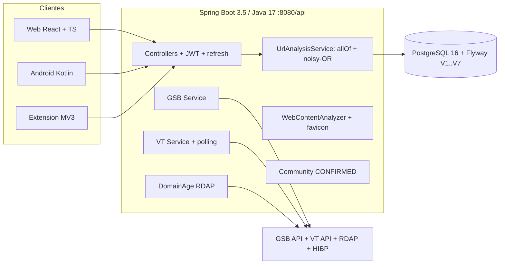

# Decisiones Arquitectónicas — PHISHWARE

## Patrón General: Clean Architecture + MVC

### Capas del Backend

```
Presentación  │  Controller  ← HTTP Request
              │      ↓
Aplicación    │  Service     ← Lógica de negocio
              │      ↓
Dominio       │  Entity      ← Modelos del dominio
              │      ↓
Datos         │  Repository  ← Acceso a BD
              │      ↓
              │  PostgreSQL  ← Persistencia
```

### Principios SOLID Aplicados

**S — Single Responsibility**
- `UrlAnalysisService`: solo orquesta el análisis
- `GoogleSafeBrowsingService`: solo llama a la API de GSB
- `GamificationService`: solo gestiona puntos y niveles
- `AuditLogService`: solo registra eventos

**O — Open/Closed**
- `RiskLevel` enum extensible sin modificar `UrlAnalysisService`
- Nuevas fuentes de análisis se añaden como beans inyectables

**L — Liskov Substitution**
- `UserDetails` implementado por `User` — Spring Security usa la interfaz

**I — Interface Segregation**
- Repositorios con interfaces específicas por entidad
- Sin repositorio "dios"

**D — Dependency Inversion**
- Services inyectados mediante `@RequiredArgsConstructor`
- `WebClient` inyectado por nombre (`@Qualifier`)

## Decisión: JWT sobre Sessions (+ refresh rotation)

**Problema**: La app debe funcionar en web y mobile.

**Decisión**: JWT stateless de acceso (24h) + refresh token rotado (7d, `POST /auth/refresh`).

**Ventajas**:
- Sin estado en servidor → escala horizontalmente
- Funciona en mobile (Android) sin cookies
- Payload con roles evita consultas extra a BD
- El refresh token (`type: refresh`) nunca es aceptado como Bearer

**Desventaja**: No revocación inmediata (mitigado con TTL corto de 24h).

## Decisión: Combinar Google Safe Browsing + VirusTotal + heurística (noisy-OR)

**Problema**: Ninguna API tiene cobertura del 100% y cada una falla distinto.

**Decisión**: Cada fuente aporta una probabilidad independiente `p_i = score × confianza`
(urlHeuristic 0.75, pageContent 0.85, domainAge 0.70, communityConfirmed 0.9)
combinadas con noisy-OR: `riesgo = 1 − Π(1 − p_i)`.

**Lógica**:
- GSB detecta: social engineering, malware, PHA (peligroso → 0.95)
- VirusTotal detecta: consenso de motores (con polling hasta el veredicto)
- La comunidad confirmada aporta una sexta señal (CONFIRMED → 0.9)
- Una fuente caída o sin clave simplemente no participa (fail-open parcial, nunca inventa riesgo)
- El score final [0-100] clasifica en SAFE <20 / SUSPICIOUS 20–49 / DANGEROUS ≥50

## Decisión: JSONB para respuestas crudas

**Problema**: Guardar respuestas completas de APIs (estructura variable).

**Decisión**: Columna `raw_response JSONB` en `url_analysis`.

**Ventaja**: Permite análisis histórico sin perder datos aunque el esquema de la API cambie.

## Componentes y flujo (v1.1)



Stack real: Spring Boot 3.5 / Java 17, React 18 + TypeScript, Kotlin MVVM + Hilt (flavors full/play), extensión MV3.
